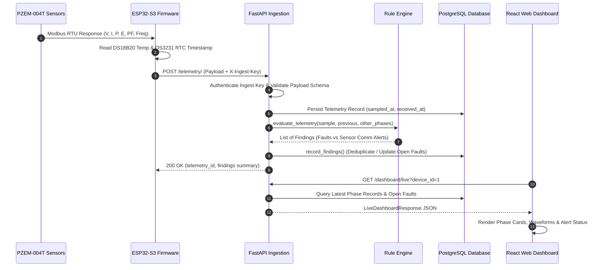

# System Architecture Document

**Document Reference:** `docs/03_ARCHITECTURE.md`
**System Title:** IoT-Based Power Monitoring & Fault Identification System
**Current Phase:** Version 1.0 (Audit, Hardening & Verification)

---

## 1. High-Level System Architecture

```
                    3-PHASE 4-WIRE AC DISTRIBUTION PANEL
                   [ Phase R ]    [ Phase Y ]    [ Phase B ]
                        │              │              │
                        ▼              ▼              ▼
                   PZEM-004T(R)   PZEM-004T(Y)   PZEM-004T(B)
                   + Split CT     + Split CT     + Split CT
                        │              │              │
                        └───────┬──────┴──────────────┘
                                │ Modbus RTU (UART / GPIO 43, 44)
                                ▼
                   SEEED STUDIO XIAO ESP32-S3
                   ├── DS18B20 Temp (OneWire / GPIO 2)
                   ├── DS3231 RTC (I2C / GPIO 5, 6)
                   └── 3x SSR-40DA Relays (GPIO 7, 8, 9)
                                │
                                │ Wi-Fi 802.11 b/g/n (HTTPS REST / JSON)
                                ▼
═══════════════════════════════════════════════════════════════════════════════
 TRUST BOUNDARY (Edge Device to Server Boundary: X-Ingest-Key / Device Auth)
═══════════════════════════════════════════════════════════════════════════════
                                │
                                ▼
                   FASTAPI APPLICATION SERVER
                   ├── Ingestion Router (/telemetry)
                   ├── Authentication & RBAC (/auth)
                   ├── Location & Device Management (/locations, /devices)
                   ├── Relay Control Service (/relays)
                   ├── Maintenance Workflow Engine (/maintenance)
                   │
                   ▼
        ┌──────────────────────────────────────┐
        │        DETERMINISTIC RULE ENGINE     │
        │ ├── Sensor / Comm Error Classifier  │
        │ ├── Loss of Voltage (Peer Check)     │
        │ ├── Overvoltage / Undervoltage       │
        │ ├── Overcurrent Trip Evaluation      │
        │ ├── 3-Phase Deviation Imbalance      │
        │ └── Sudden Delta Spike Tracking      │
        └──────────────────────────────────────┘
             │                            │
             ▼                            ▼
    POSTGRESQL DATABASE          FAULT DEDUPLICATION &
    ├── Telemetry Timeseries     NOTIFICATION DISPATCHER
    ├── Device Registry          ├── Open Fault Record Update
    ├── Campus Hierarchy         └── In-App Alerts Table
    └── Maintenance Work Orders
             │
             │ JSON REST APIs (HTTP / WebSockets)
             ▼
═══════════════════════════════════════════════════════════════════════════════
 USER TRUST BOUNDARY (JWT Bearer Token: Admin / Operator / Technician)
═══════════════════════════════════════════════════════════════════════════════
             │
             ▼
    REACT 19 + TYPESCRIPT WEB DASHBOARD
    ├── Live Phase Telemetry Cards & Aggregates
    ├── Interactive Time-Series Charts (Recharts)
    ├── Fault Management & Triage Workflow
    ├── Maintenance Dispatch Kanban & Attempts
    ├── Campus Topology Drill-Down
    └── Audit Trail & Simulator Modal
```

---

## 2. Component Responsibilities & Module Decomposition

### 2.1 Microcontroller Firmware (`firmware/`) — *Phase F Milestone*
- **Peripheral Orchestration:** Initializes UART (GPIO 43/44), OneWire bus (GPIO 2), and I2C bus (GPIO 5/6).
- **Modbus RTU Polling:** Queries PZEM modules sequentially using distinct Modbus slave IDs (`0x01` Phase R, `0x02` Phase Y, `0x03` Phase B).
- **Time Synchronization:** Reads battery-backed DS3231 RTC to obtain microsecond-accurate UTC timestamps (`sampled_at`).
- **Telemetry Framing:** Packages validated readings into JSON payloads and handles network buffering during transient Wi-Fi drops.
- **Fail-Safe Actuation:** Drives SSR-40DA opto-isolated triggers with local hardware interlocks and watchdog timers.

### 2.2 Backend Application Server (`backend/app/`) — *Implemented*
- **`app/api/` (API Routers):** Exposes clean REST endpoints for authentication, device ingestion, campus topology, maintenance, relays, and dashboard feeds.
- **`app/core/` (Security & Config):** Manages Pydantic environment configuration (`config.py`) and cryptographic security (`security.py`: PBKDF2 password hashing, JWT signing).
- **`app/models/` (SQLAlchemy ORM):** Declares normalized database schemas with declarative relational integrity.
- **`app/rules/` (Rule Engine):** Houses domain logic isolating data quality anomalies from genuine electrical abnormalities.
- **`app/services/` (Business Logic):** Handles fault deduplication, device health aggregation, work order state machines, and audit logging.

### 2.3 Persistence Layer (`database/`) — *Implemented*
- **PostgreSQL / SQLite:** Relational persistence for telemetry samples, fault histories, user credentials, and campus hierarchy.
- **Alembic:** Version-controlled database migration tracking.

### 2.4 Frontend Dashboard (`frontend/src/`) — *Implemented*
- **Client Application:** React 19 single-page application built with Vite and TypeScript.
- **State & Service Layer:** Centralized Axios client (`api.ts`) managing live polling, data mapping, and demo fallback state.
- **Component Hierarchy:** Modular components for metrics, charts, fault triage, maintenance, and audit exploration.

---

## 3. End-to-End Data Flow



---

## 4. Error Handling & Fault Classification Philosophy

The system enforces an essential engineering principle: **A sensor or communication error must never be misrepresented as an electrical power failure.**

### 4.1 Sensor / Communication Errors
- **Triggers:** Modbus UART CRC error, serial timeout, reported `data_quality` in `["bad", "error", "comm_error", "timeout", "offline"]`, or out-of-range physical values ($V < 0$, $I < 0$, $PF > 1.0$).
- **Classification:** Categorized as `sensor_communication` with severity `warning`.
- **System Impact:** Suppresses electrical fault evaluation for that sample to prevent false tripping or erroneous dispatch.

### 4.2 Genuine Electrical Faults
- **Loss of Voltage:** Triggered when phase voltage falls below $15.0\text{ V}$ **while at least one companion phase has verified healthy voltage ($>15.0\text{ V}$)**. If all three phases read zero simultaneously without prior warning, the system classifies it as a general power interruption or sensor outage, not single-phase loss.
- **Voltage Violations:** Undervoltage ($< 195.5\text{ V}$) and Overvoltage ($> 253.0\text{ V}$) computed against nominal $230\text{ V}$.
- **Overcurrent:** Current exceeds the site-configured protection rating ($> 32\text{ A}$).
- **Phase Imbalance:** Voltage deviation from the 3-phase average exceeds $10.0\%$.

---

## 5. Security Architecture & Trust Boundaries

```
[ UNTRUSTED NETWORK ]
        │
        │ TLS 1.3 / HTTPS (Port 443)
        ▼
[ REVERSE PROXY / NGINX ]
  ├── Enforces CORS Origin Restrictions
  ├── TLS Termination
  └── Rate Limiting
        │
        ▼ (Local Unix Socket / Loopback HTTP Port 8000)
[ FASTAPI APPLICATION LAYER ]
  ├── Trust Boundary 1: Hardware Ingestion (X-Ingest-Key Device Secret)
  ├── Trust Boundary 2: Operator / Admin (JWT Bearer Token + Role Checks)
  └── Parameterized ORM Access (No raw SQL string concatenation)
        │
        ▼
[ POSTGRESQL DATABASE ]
  └── Least-privilege application user
```

---

## 6. Implementation Status Matrix

| Subsystem | Implemented in Repo | Verified at Runtime | Target Milestone |
|---|---|---|---|
| FastAPI Ingestion & Routers | **Yes** | **Yes** (13 tests pass) | V1 Core |
| SQLAlchemy ORM Models | **Yes** | **Yes** | V1 Core |
| Deterministic Rule Engine | **Yes** | **Yes** (13 tests pass) | V1 Core |
| Maintenance Work Order Workflow | **Yes** | **Yes** (Verified) | V1 Core |
| React 19 Frontend Dashboard | **Yes** | **Yes** (Builds cleanly) | V1 Core |
| ESP32-S3 Firmware | **No** (Directory empty) | **No** | Phase F |
| MATLAB Grid Simulation | **No** (Directory empty) | **No** | Phase G |
| ML Predictive Maintenance Models| **No** (Directory empty) | **No** | Phase I |
