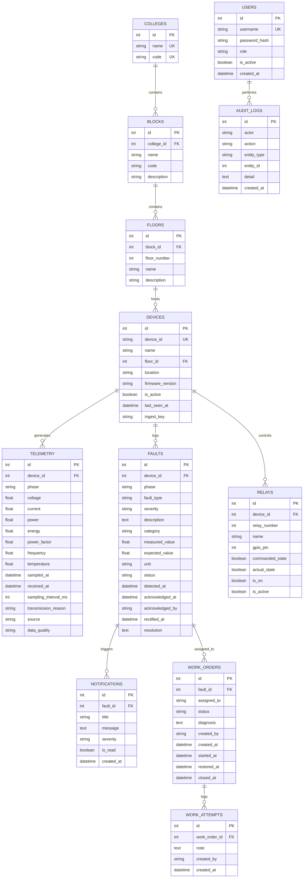

# Database Documentation

**Document Reference:** `docs/04_DATABASE.md`
**System Title:** IoT-Based Power Monitoring & Fault Identification System
**Current Phase:** Version 1.0 (Audit, Hardening & Verification)

---

## 1. Database Overview & Technology Stack

- **Target Engine:** PostgreSQL 15+ (Production) / SQLite 3 (Local Unit Testing).
- **ORM / Abstraction:** SQLAlchemy 2.0 (Mapped Annotations & DeclarativeBase).
- **Migration Framework:** Alembic.
- **Timestamp Standard:** Timezone-aware UTC (`DateTime(timezone=True)`).
- **Session Management:** FastAPI dependency injection (`get_db`) yielding scoped `SessionLocal` sessions with explicit commit/rollback boundaries.

---

## 2. Entity-Relationship Diagram (ERD)

---

## 3. Detailed Table Schema Definitions

### 3.1 `colleges`
| Column | Type | Constraints | Description |
|---|---|---|---|
| `id` | `INTEGER` | `PRIMARY KEY`, indexed | Auto-incrementing identifier |
| `name` | `VARCHAR(150)` | `NOT NULL`, `UNIQUE` | College or campus name |
| `code` | `VARCHAR(30)` | `NULLABLE`, `UNIQUE` | Institutional code (e.g. `GEC-01`) |

### 3.2 `blocks`
| Column | Type | Constraints | Description |
|---|---|---|---|
| `id` | `INTEGER` | `PRIMARY KEY`, indexed | Auto-incrementing identifier |
| `college_id` | `INTEGER` | `NOT NULL`, `FOREIGN KEY (colleges.id)` | Parent college association |
| `name` | `VARCHAR(100)` | `NOT NULL` | Building/block name |
| `code` | `VARCHAR(30)` | `NULLABLE` | Block code (e.g. `BLK-EE`) |
| `description` | `VARCHAR(255)` | `NULLABLE` | Facility description |

### 3.3 `floors`
| Column | Type | Constraints | Description |
|---|---|---|---|
| `id` | `INTEGER` | `PRIMARY KEY`, indexed | Auto-incrementing identifier |
| `block_id` | `INTEGER` | `NOT NULL`, `FOREIGN KEY (blocks.id)` | Parent block association |
| `floor_number` | `INTEGER` | `NOT NULL` | Physical level (0 = Ground, 1 = 1st) |
| `name` | `VARCHAR(100)` | `NOT NULL` | Floor label (e.g. `Ground Floor Substation Panel`) |
| `description` | `VARCHAR(255)` | `NULLABLE` | Sub-panel description |

### 3.4 `devices`
| Column | Type | Constraints | Description |
|---|---|---|---|
| `id` | `INTEGER` | `PRIMARY KEY`, indexed | Auto-incrementing internal surrogate key |
| `device_id` | `VARCHAR(50)` | `NOT NULL`, `UNIQUE`, indexed | Hardware string ID (e.g. `XIAO-PM-001`) |
| `name` | `VARCHAR(100)` | `NOT NULL` | Human-readable descriptor |
| `floor_id` | `INTEGER` | `NULLABLE`, `FOREIGN KEY (floors.id)` | Location link |
| `location` | `VARCHAR(100)` | `NULLABLE` | Descriptive physical mounting location |
| `firmware_version` | `VARCHAR(30)` | `NULLABLE` | Flashed firmware version string |
| `is_active` | `BOOLEAN` | `NOT NULL`, default `TRUE` | Enable/disable ingestion flag |
| `last_seen_at` | `TIMESTAMPTZ` | `NULLABLE` | Server receipt time of latest valid sample |
| `ingest_key` | `VARCHAR(80)` | `NULLABLE` | Pre-shared API key for device authentication |

### 3.5 `telemetry`
| Column | Type | Constraints | Description |
|---|---|---|---|
| `id` | `INTEGER` | `PRIMARY KEY`, indexed | Unique reading ID |
| `device_id` | `INTEGER` | `NOT NULL`, `FOREIGN KEY (devices.id)` | Monitored device link |
| `phase` | `VARCHAR(10)` | `NOT NULL` | Phase identifier (`R`, `Y`, `B`) |
| `voltage` | `FLOAT` | `NULLABLE` | RMS phase-to-neutral voltage ($V$) |
| `current` | `FLOAT` | `NULLABLE` | RMS phase current ($A$) |
| `power` | `FLOAT` | `NULLABLE` | Active power ($W$) |
| `energy` | `FLOAT` | `NULLABLE` | Cumulative active energy ($kWh$) |
| `power_factor` | `FLOAT` | `NULLABLE` | Power factor ($0.00$ to $1.00$) |
| `frequency` | `FLOAT` | `NULLABLE` | Supply frequency ($Hz$) |
| `temperature` | `FLOAT` | `NULLABLE` | DS18B20 monitored temperature ($^\circ\text{C}$) |
| `sampled_at` | `TIMESTAMPTZ` | `NOT NULL`, indexed | Timestamp recorded by device RTC |
| `received_at` | `TIMESTAMPTZ` | `NOT NULL`, indexed | Timestamp assigned upon server receipt |
| `sampling_interval_ms` | `INTEGER` | `NULLABLE` | Interval used by firmware |
| `transmission_reason` | `VARCHAR(30)` | `NOT NULL` | `SCHEDULED`, `FAULT_EVENT`, `RELAY_EVENT` |
| `source` | `VARCHAR(20)` | `NOT NULL` | `REAL`, `SIMULATION`, `TEST` |
| `data_quality` | `VARCHAR(20)` | `NULLABLE` | Quality tag (`good`, `ok`, `bad`, `comm_error`) |

### 3.6 `faults`
| Column | Type | Constraints | Description |
|---|---|---|---|
| `id` | `INTEGER` | `PRIMARY KEY`, indexed | Unique fault incident ID |
| `device_id` | `INTEGER` | `NOT NULL`, `FOREIGN KEY (devices.id)` | Originating device |
| `phase` | `VARCHAR(10)` | `NULLABLE` | Affected phase (`R`, `Y`, `B`, or `NULL` for 3-phase) |
| `fault_type` | `VARCHAR(50)` | `NOT NULL` | `OVERCURRENT`, `UNDERVOLTAGE`, etc. |
| `severity` | `VARCHAR(20)` | `NOT NULL`, default `warning` | `warning`, `fault`, `info` |
| `description` | `TEXT` | `NULLABLE` | Detailed explanation of anomaly |
| `category` | `VARCHAR(30)` | `NOT NULL`, indexed | `electrical` or `sensor_communication` |
| `measured_value` | `FLOAT` | `NULLABLE` | Recorded abnormal value |
| `expected_value` | `FLOAT` | `NULLABLE` | Threshold or baseline expected value |
| `unit` | `VARCHAR(20)` | `NULLABLE` | Measurement unit (`V`, `A`, `W`, `°C`, `%`) |
| `status` | `VARCHAR(20)` | `NOT NULL`, indexed | `detected`, `acknowledged`, `rectified` |
| `detected_at` | `TIMESTAMPTZ` | `NOT NULL`, indexed | Detection timestamp |
| `acknowledged_at` | `TIMESTAMPTZ` | `NULLABLE` | Acknowledgment timestamp |
| `acknowledged_by` | `VARCHAR(100)` | `NULLABLE` | Name/ID of operator acknowledging |
| `rectified_at` | `TIMESTAMPTZ` | `NULLABLE` | Resolution timestamp |
| `resolution` | `TEXT` | `NULLABLE` | Field technician resolution notes |

### 3.7 `work_orders` & `work_attempts`
| Table | Column | Type | Constraints | Description |
|---|---|---|---|---|
| `work_orders` | `id` | `INTEGER` | `PRIMARY KEY` | Work order ticket number |
| `work_orders` | `fault_id` | `INTEGER` | `NOT NULL`, `FK (faults.id)` | Associated incident |
| `work_orders` | `assigned_to` | `VARCHAR(100)` | `NOT NULL` | Assignee technician |
| `work_orders` | `status` | `VARCHAR(20)` | `NOT NULL` | `assigned`, `in_progress`, `restored`, `closed` |
| `work_orders` | `diagnosis` | `TEXT` | `NULLABLE` | Root cause findings |
| `work_orders` | `created_by` | `VARCHAR(100)` | `NULLABLE` | Dispatching actor |
| `work_orders` | `created_at` | `TIMESTAMPTZ` | `NOT NULL` | Ticket creation timestamp |
| `work_orders` | `started_at` | `TIMESTAMPTZ` | `NULLABLE` | Work commenced timestamp |
| `work_orders` | `restored_at` | `TIMESTAMPTZ` | `NULLABLE` | Power restored timestamp |
| `work_orders` | `closed_at` | `TIMESTAMPTZ` | `NULLABLE` | Formal sign-off timestamp |
| `work_attempts` | `id` | `INTEGER` | `PRIMARY KEY` | Attempt note entry ID |
| `work_attempts` | `work_order_id`| `INTEGER` | `NOT NULL`, `FK (work_orders.id)` | Parent ticket link |
| `work_attempts` | `note` | `TEXT` | `NOT NULL` | Diagnostic work log note |
| `work_attempts` | `created_by` | `VARCHAR(100)` | `NULLABLE` | Author technician |
| `work_attempts` | `created_at` | `TIMESTAMPTZ` | `NOT NULL` | Log timestamp |

### 3.8 `relays`
| Column | Type | Constraints | Description |
|---|---|---|---|
| `id` | `INTEGER` | `PRIMARY KEY`, indexed | Relay channel identifier |
| `device_id` | `INTEGER` | `NOT NULL`, `FOREIGN KEY (devices.id)` | Host monitoring device |
| `relay_number` | `INTEGER` | `NOT NULL` | Channel number (1, 2, 3) |
| `name` | `VARCHAR(100)` | `NOT NULL` | Descriptive name (e.g. `SSR-R`) |
| `gpio_pin` | `INTEGER` | `NULLABLE` | Microcontroller GPIO (e.g. `7`, `8`, `9`) |
| `commanded_state`| `BOOLEAN` | `NOT NULL`, default `FALSE` | Requested logical state |
| `actual_state` | `BOOLEAN` | `NULLABLE` | Hardware-confirmed state from device |
| `is_on` | `BOOLEAN` | `NOT NULL`, default `FALSE` | Legacy display state |
| `is_active` | `BOOLEAN` | `NOT NULL`, default `TRUE` | Actuation safety enable flag |

### 3.9 `users`, `notifications`, `audit_logs`
| Table | Column | Type | Constraints | Description |
|---|---|---|---|---|
| `users` | `id` | `INTEGER` | `PRIMARY KEY` | User identifier |
| `users` | `username` | `VARCHAR(80)` | `NOT NULL`, `UNIQUE` | Login identity |
| `users` | `password_hash`| `VARCHAR(255)` | `NOT NULL` | PBKDF2-HMAC-SHA256 hash |
| `users` | `role` | `VARCHAR(30)` | `NOT NULL` | `admin`, `operator`, `technician` |
| `users` | `is_active` | `BOOLEAN` | `NOT NULL`, default `TRUE` | Account enable flag |
| `users` | `created_at` | `TIMESTAMPTZ` | `NOT NULL` | Account creation timestamp |
| `notifications`| `id` | `INTEGER` | `PRIMARY KEY` | Alert notification ID |
| `notifications`| `fault_id` | `INTEGER` | `NULLABLE`, `FK (faults.id)` | Triggering fault link |
| `notifications`| `title` | `VARCHAR(120)` | `NOT NULL` | Alert title string |
| `notifications`| `message` | `TEXT` | `NOT NULL` | Alert description |
| `notifications`| `severity` | `VARCHAR(20)` | `NOT NULL` | `warning`, `fault`, `info` |
| `notifications`| `is_read` | `BOOLEAN` | `NOT NULL`, default `FALSE` | Read state flag |
| `notifications`| `created_at` | `TIMESTAMPTZ` | `NOT NULL` | Notification timestamp |
| `audit_logs` | `id` | `INTEGER` | `PRIMARY KEY` | Audit entry ID |
| `audit_logs` | `actor` | `VARCHAR(100)` | `NOT NULL` | Acting user or system |
| `audit_logs` | `action` | `VARCHAR(100)` | `NOT NULL` | Performed operation |
| `audit_logs` | `entity_type` | `VARCHAR(50)` | `NOT NULL` | Target entity (`user`, `relay`, etc.) |
| `audit_logs` | `entity_id` | `INTEGER` | `NULLABLE` | Target entity primary key |
| `audit_logs` | `detail` | `TEXT` | `NULLABLE` | Sanitized context payload |
| `audit_logs` | `created_at` | `TIMESTAMPTZ` | `NOT NULL` | Immutable audit timestamp |

---

## 4. Migration History & Resolution

### Migration Chain:
1. `53f1a59aca1d_create_devices_table.py` (Revision ID: `53f1a59aca1d`, down_revision: `None`): Baseline schema provisioning all 12 tables (`colleges`, `blocks`, `floors`, `devices`, `telemetry`, `relays`, `faults`, `users`, `notifications`, `work_orders`, `work_attempts`, `audit_logs`) and indexes in topological order.
2. `4a921bc8c9a8_add_missing_columns.py` (Revision ID: `4a921bc8c9a8`, down_revision: `53f1a59aca1d`): Adds `last_seen_at`, `ingest_key` to `devices`; `category`, `measured_value`, `expected_value`, `unit` to `faults`; `gpio_pin`, `commanded_state`, `actual_state` to `relays`.
3. `7b831cd9e102_add_user_location_scope.py` (Revision ID: `7b831cd9e102`, down_revision: `4a921bc8c9a8`): Adds `assigned_block_id` and `assigned_floor_id` to `users`.

### Idempotency & Multi-Environment Support:
- **Primary Migration Command:** Always execute `alembic upgrade head` for both fresh installations and existing databases.
  - **Clean Database:** Runs revisions `53f1a59aca1d -> 4a921bc8c9a8 -> 7b831cd9e102`, creating all 12 tables, foreign keys, and indexes in topological order.
  - **Existing / Upgraded Database:** Alembic migrations feature object existence checks (`sa.inspect`) for tables, columns, constraints, and indexes. Running `alembic upgrade head` safely detects existing objects and applies any missing columns or constraints before advancing `alembic_version` to `head` (`7b831cd9e102`), preserving existing data without collision errors.
- **`alembic stamp head` Usage Constraint:** `alembic stamp head` must **never** be used as a substitute for `alembic upgrade head` on arbitrary or legacy databases. Stamping only writes the revision identifier to `alembic_version` without executing any DDL, leaving any missing tables, columns, or foreign keys uncreated. `alembic stamp head` is reserved exclusively for instances where the complete, current schema was just freshly generated via `Base.metadata.create_all(bind=engine)` in the current code revision.
