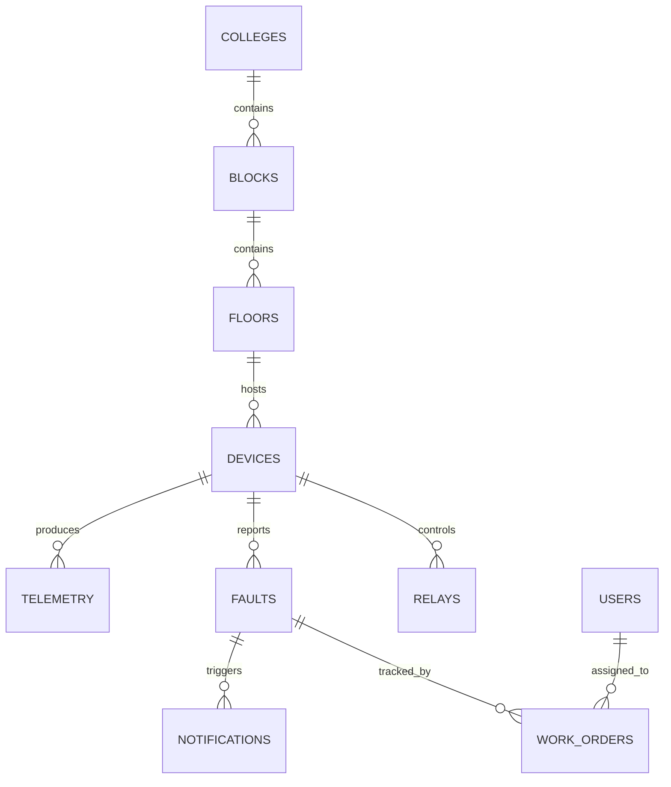

# Database Design

## 1. Technology and principles

- PostgreSQL is the target database.
- SQLAlchemy 2 models and Alembic migrations are the application interface.
- UTC-aware timestamps; store device sample time separately from server receipt time.
- Keep the MVP schema close to the current repository models. Add constraints/indexes through migrations after verifying existing data.
- Do not enable row-level security for the single-site MVP without an approved tenant/site isolation requirement.

## 2. Tables

The column list below describes the current conceptual schema and recommended constraints. Exact existing model fields should be checked before writing migrations.

### `users`
- `id`: integer, primary key.
- `username`: varchar(80), unique, not null.
- `password_hash`: varchar(255), not null.
- `role`: varchar(30), not null; values `operator`, `shift_incharge`, `electrical_engineer`, `management`, `technician`, `admin`.
- `assigned_block_id`: integer FK → `blocks.id`, nullable (location scope).
- `assigned_floor_id`: integer FK → `floors.id`, nullable (location scope).
- `is_active`: boolean, not null, default true.
- `created_at`: timestamptz, not null.
- Migration reference: `7b831cd9e102_add_user_location_scope.py`.
- Constraints: role check; normalize/validate username consistently. Password plaintext must never be stored.

### `colleges`
- `id`: integer PK.
- `name`: varchar(150), unique, not null.
- `code`: varchar(30), unique, nullable.
- `is_active`: boolean, not null, default true.

### `blocks`
- `id`: integer PK.
- `college_id`: integer FK → `colleges.id`, not null.
- `name`: varchar(100), not null.
- `code`: varchar(30), nullable.
- `description`: varchar(255), nullable.
- `is_active`: boolean, not null, default true.
- Recommended uniqueness: `(college_id, name)` or `(college_id, code)` if code is present and policy confirms it.

### `floors`
- `id`: integer PK.
- `block_id`: integer FK → `blocks.id`, not null.
- `floor_number`: integer, not null.
- `name`: varchar(100), not null.
- `description`: varchar(255), nullable.
- `is_active`: boolean, not null, default true.
- Recommended uniqueness: `(block_id, floor_number)`.

### `devices`
- `id`: integer PK.
- `device_id`: varchar(50), unique, not null; public device identifier, not a credential.
- `name`: varchar(100), not null.
- `floor_id`: integer FK → `floors.id`, nullable.
- `location`: varchar(100), nullable.
- `firmware_version`: varchar(30), nullable.
- `is_active`: boolean, not null, default true.
- `last_seen_at`: timestamptz, nullable.
- `ingest_key`: varchar(80), nullable in current model; **security-sensitive**. Prefer storing a strong hash or migrating to a separate credential record with rotation/revocation metadata. Never return it through APIs.
- Constraint: unique device ID; only active, provisioned devices can ingest.

### `telemetry`
- `id`: integer PK.
- `device_id`: integer FK → `devices.id`, not null.
- `phase`: varchar(10), not null; allowed values `R`, `Y`, `B`.
- `voltage`, `current`, `power`, `energy`, `power_factor`, `frequency`, `temperature`: nullable numeric values; prefer `DOUBLE PRECISION` or chosen fixed precision consistently.
- `sampled_at`: timestamptz, not null.
- `received_at`: timestamptz, not null.
- `sampling_interval_ms`: integer, nullable; if present must be positive.
- `transmission_reason`: varchar(30), not null; documented values `SCHEDULED`, `PARAMETER_CHANGE`, `FAULT_EVENT`, `RELAY_EVENT`, `DEVICE_EVENT`.
- `source`: varchar(20), not null; allowed `REAL`, `SIMULATION`, `TEST`.
- `data_quality`: varchar(20), nullable; define canonical allowed values before enforcing a check.
- Recommended checks: finite numeric values; nonnegative current/power/energy where physically applicable; plausible ranges must be installation-configured rather than arbitrary universal limits.
- Recommended index: `(device_id, phase, sampled_at DESC)` for history/latest-by-phase; `(device_id, sampled_at DESC)` for device-wide recent history. Avoid duplicate indexes if a migration already provides equivalent ones.

### `faults`
- `id`: integer PK.
- `device_id`: integer FK → `devices.id`, not null.
- `phase`: varchar(10), nullable.
- `fault_type`: varchar(50), not null.
- `severity`: varchar(20), not null, default `warning`.
- `description`: text, nullable.
- `category`: varchar(30), not null, default `electrical`.
- `measured_value`, `expected_value`: nullable numeric.
- `unit`: varchar(20), nullable.
- `status`: varchar(20), not null, default `detected`.
- `detected_at`: timestamptz, not null.
- `acknowledged_at`: timestamptz, nullable.
- `acknowledged_by`: varchar(100), nullable in current schema; future preferred FK to `users.id` if user lifecycle supports it.
- `rectified_at`: timestamptz, nullable.
- `resolution`: text, nullable.
- Recommended indexes: `(status, detected_at DESC)`, `(device_id, detected_at DESC)`, `(category, status)`.
- Define canonical statuses/categories/severities in one place. Use partial uniqueness for open-fault deduplication only after defining the exact deduplication key.

### `notifications`
- Current model exists. Expected relationship: many notifications can reference one fault.
- Preserve only required fields found in `backend/app/models/notification.py`; do not infer missing fields.
- Recommended FK to `faults.id`, created timestamp, recipient/target if delivery requires it, delivery/read status if UI requires it.
- External email/SMS delivery is not assumed.

### `work_orders`
- Current model exists and links maintenance workflow to a fault.
- Preserve fields from `backend/app/models/work_order.py`; expected functional concepts are assignee, status, diagnosis/resolution, created/updated timestamps.
- Recommended FK to `faults.id` and user assignment FK if supported by current model.
- Add status check and indexes for status/assignee/time after confirming actual field names.
- Work attempts may be stored in a separate table if the current model already defines it; verify the repository model before changing schema. The API requirements expect chronological attempts, so the chosen representation must be durable and queryable.

### `relays`
- `id`: integer PK.
- `device_id`: integer FK → `devices.id`, not null.
- `relay_number`: integer, not null.
- `name`: varchar(100), not null.
- `gpio_pin`: integer, nullable.
- `commanded_state`: boolean, not null, default false.
- `actual_state`: boolean, nullable.
- `is_on`: boolean, not null, default false in current model.
- `is_active`: boolean, not null, default true.
- Recommended unique constraint: `(device_id, relay_number)`.
- Important: do not treat `is_on` or `commanded_state` as actual physical confirmation. Prefer one canonical commanded-state field and a separately acknowledged actual state; resolve legacy `is_on` duplication in a planned migration, not an unreviewed edit.

### `audit_logs` (model currently named according to repository)
- Audit record for actor, action, entity/resource, timestamp and safe detail.
- Preserve exact columns in `backend/app/models/audit.py`.
- Never store passwords, JWTs, device secrets or raw authorization headers.
- Recommended index on timestamp and optionally `(entity_type, entity_id)` if those fields exist.

## 3. Relationships / ER diagram

The user/work-order relationship depends on the actual current model FK; confirm it before applying schema changes.

## 4. Ownership and authorization

- All application data access goes through the backend.
- `device_id` identifies a device but does not authenticate it.
- Only authenticated, provisioned devices can insert telemetry for themselves.
- Human role permissions are checked server-side.
- Technician assignment scope must be enforced if the product requires technicians to see only assigned jobs.
- The MVP is single-site; there is no tenant key or row-level security in the current design.

## 5. Migrations and seed strategy

- Use Alembic for all changes.
- Inspect current migration history and live schema before writing migrations.
- Never recreate tables or drop data to align with this document.
- Seed only minimal development data in an explicit development/test command.
- Never seed production with known passwords or default signing secrets.
- Add migrations for constraints/indexes only after checking duplicates/invalid existing records.

## 6. Retention, backup and recovery

- Telemetry grows continuously; set an owner-approved retention period before automatic deletion or partitioning.
- Back up PostgreSQL on a documented schedule appropriate to the deployment; store backups outside the database host.
- Restrict backup access because data may reveal facility operation patterns.
- Test restore into a separate environment and document recovery time/data-loss objectives.
- Export/backup automation is listed as unfinished in the current task document; do not claim it is operational.

## 7. Approval items

- Retention duration and backup schedule.
- Exact notification/work-order/audit columns after current model inspection.
- Whether `acknowledged_by` should become a user FK.
- Whether device credentials are stored hashed or moved to a dedicated credentials table.
- Whether relay legacy state fields should be consolidated.
- Whether the system will ever support multiple colleges/tenants with strict data isolation.
